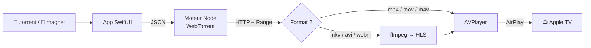

<div align="center">


# ToStream

**Glisse un torrent. Regarde-le sur ton Apple TV. Sans attendre la fin du téléchargement.**


<sub>Une petite app Mac, pensée pour un seul usage : lire ses torrents de contenu libre de droits sur la grande télé.</sub>

</div>

---

## ✨ En un coup d'œil

```
  📄 fichier .torrent        ┌────────────┐        📺 Apple TV
  🧲 ou lien magnet   ─────▶ │  ToStream  │ ─────▶  (AirPlay)
                             └────────────┘
                     télécharge · convertit · diffuse
```

1. **Connecte ton Apple TV** avec le bouton AirPlay en haut à droite. La connexion reste ouverte.
2. **Glisse** un `.torrent` dans la fenêtre (ou colle un lien magnet avec `⌘V`).
3. **Regarde.** La lecture démarre dès que le début du fichier est là.

## 🎯 Fonctionnalités

| | |
|---|---|
| ⚡ **Lecture immédiate** | Téléchargement séquentiel, servi en HTTP au lecteur pendant qu'il arrive. |
| 📺 **AirPlay intégré** | Choisis l'Apple TV *avant* le torrent : une vidéo de veille garde la connexion ouverte. Code de première connexion pris en charge. |
| 🎞️ **Tous les formats** | `mp4`, `mov`, `m4v` en direct. `mkv`, `avi`, `webm`, H.265… convertis à la volée en HLS. |
| 🛡️ **Jamais sur le Mac par erreur** | Le flux reste en pause tant que l'Apple TV n'est pas connectée. Connexion perdue = pause automatique. |
| 🎛️ **Vraies commandes** | Lecture/pause, ±10 s, barre de progression, menu *Lecture* et raccourcis clavier. |
| 🧰 **Autonome** | Node.js est embarqué, ffmpeg s'installe en un clic, **sans Homebrew**. |
| 🪶 **Léger** | Environ **40 Mo** en zip pour une architecture, 80 Mo en universel. |
| 🧹 **Propre** | Les fichiers temporaires disparaissent quand tu arrêtes la lecture. |

## ⌨️ Raccourcis

| Touche | Action |
|---|---|
| `Espace` | Lecture / pause |
| `←` / `→` | Reculer / avancer de 10 s |
| `⌘ .` | Arrêter |
| `⌘ V` | Coller un lien magnet |

## 🚀 Installation

### Prérequis pour compiler

- macOS 13 ou plus récent
- Les **Command Line Tools** d'Apple : `xcode-select --install`
- **Node.js + npm** (uniquement pour compiler : l'app finale embarque son propre Node)

### Compiler

```bash
git clone <ton-repo> ToStream && cd ToStream
./build.sh              # universel : Apple Silicon + Intel
./build.sh arm64        # Apple Silicon seulement (le plus léger)
./build.sh x86_64       # Intel seulement
```

Le script produit **`ToStream.app`** et un zip prêt à partager (`ToStream-<mode>.zip`). Glisse l'app dans *Applications*.

> **Premier lancement.** L'app est signée localement (ad-hoc), pas par un compte développeur Apple. Si macOS la bloque : clic droit → **Ouvrir**, ou *Réglages Système → Confidentialité et sécurité → Ouvrir quand même*. Autorise aussi l'accès au **réseau local**, indispensable pour parler à l'Apple TV.

## 🔐 Code de connexion sur l'Apple TV

C'est l'Apple TV qui décide si elle demande un code, pas l'app. Pour l'exiger :

**Apple TV → Réglages → AirPlay et HomeKit → Autoriser l'accès** → *Tout le monde* ou *Toute personne du même réseau*, puis activer **Exiger un code** (*Première fois uniquement* ou *Toujours*).

Au moment de choisir l'Apple TV, le code s'affiche sur la télé et le Mac ouvre la fenêtre de saisie.

## 🧠 Comment ça marche



- **App** : SwiftUI + AVKit. Un unique `AVPlayer` est lié au bouton AirPlay, ce qui permet de se connecter avant d'avoir une vidéo.
- **Moteur** : un process Node (WebTorrent) piloté en JSON sur stdin/stdout. Il choisit le plus gros fichier vidéo et le sert en HTTP sur l'IP locale, pour que l'Apple TV puisse le récupérer.
- **Conversion** : si le format n'est pas lisible par l'Apple TV, ffmpeg le remuxe (H.264) ou le ré-encode (H.265 → H.264 via VideoToolbox) en HLS.

### Structure

```
ToStream/
├── Sources/ToStream/     App SwiftUI (UI, lecteur, AirPlay, pilotage du moteur, logs)
├── engine/engine.mjs     Moteur torrent + HLS
├── Resources/            Icône (AppIcon.iconset)
├── tools/make_icon.swift Générateur du logo
├── build.sh              Compilation, élagage, signature, zip
└── index.html            Page de présentation
```

## 🩺 Dépannage

<details>
<summary><b>La vidéo ne part pas sur l'Apple TV</b></summary>

- Mac et Apple TV doivent être sur le **même réseau**.
- Vérifie *Réglages Système → Confidentialité et sécurité → Réseau local* : ToStream doit être autorisé.
- Choisis l'Apple TV avec le bouton AirPlay en haut à droite, puis relance le torrent.
</details>

<details>
<summary><b>Un .mkv / .avi ne se lance pas</b></summary>

ffmpeg est nécessaire. Clique sur **Installer ffmpeg** sur l'écran d'accueil : il est téléchargé dans `~/Library/Application Support/ToStream/bin`. Le démarrage d'un gros H.265 peut prendre quelques secondes, le temps de la conversion.
</details>

<details>
<summary><b>Où sont les logs ?</b></summary>

`~/Library/Logs/ToStream/tostream.log` (le précédent est gardé en `.old`). Le bouton **Ouvrir les logs** de l'accueil les ouvre directement. Utile pour tout diagnostiquer : moteur, torrent, ffmpeg, AirPlay.
</details>

<details>
<summary><b>macOS refuse d'ouvrir l'app</b></summary>

Elle n'est pas notariée. Clic droit → **Ouvrir**, ou *Confidentialité et sécurité → Ouvrir quand même*.
</details>

## ⚖️ Usage et légalité

ToStream est un outil **personnel**, conçu pour lire du contenu **libre de droits ou dont tu détiens les droits** (films Blender, domaine public, Internet Archive, créations perso…). Tu es seul responsable de ce que tu télécharges et diffuses : respecte le droit d'auteur de ton pays.

## 🙏 Crédits

- [WebTorrent](https://webtorrent.io) : le moteur torrent en streaming.
- [FFmpeg](https://ffmpeg.org) : la conversion à la volée. Les binaires statiques macOS sont téléchargés depuis [ffmpeg.martin-riedl.de](https://ffmpeg.martin-riedl.de).
- [Node.js](https://nodejs.org) : embarqué dans l'app.

<div align="center">

<sub>Fait avec ♥ pour regarder ses torrents libres sur la grande télé.</sub>

</div>
